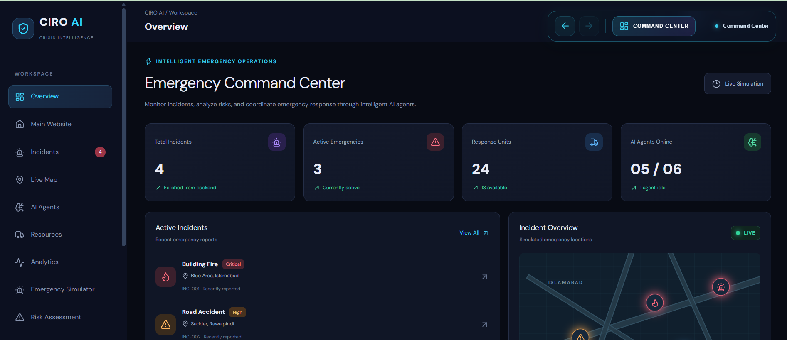
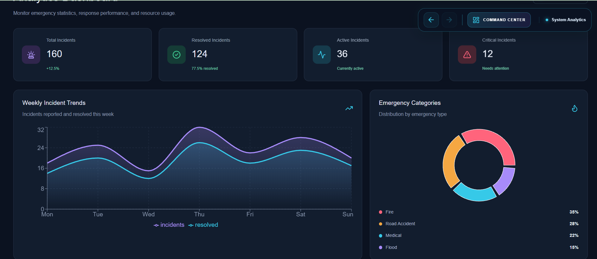

# CIRO AI
### Crisis Intelligence and Response Orchestrator

**An AI powered crisis intelligence and response decision support prototype.**

[Live Demo](https://ciro-ai.vercel.app/)

---

## Project Overview

CIRO AI is a web based simulation project designed to demonstrate how AI agents can support the analysis of emergency scenarios.

Users can submit a simulated incident with its type, location, severity, and number of people affected. The system processes the information through six specialized agent roles and presents an analysis with suggested actions and a response plan.

This project was developed as a Software Engineering project to explore AI integration, multi agent workflows, and crisis decision support.

## Project Screenshots

Explore the main interfaces and features of CIRO AI.

### 1. Landing Page

The main landing page introduces CIRO AI, its purpose, and its key features.

### 2. Dashboard

The dashboard displays simulated emergency incidents and provides an overview of the system.

### 3. Emergency Simulator

The simulator allows users to enter emergency details, including incident type, location, severity, and people affected.

### 4. AI Agents

This section presents the six specialized agent roles involved in the simulated crisis analysis workflow.

### 5. Analytics

The analytics interface presents visual information and insights from the simulated incident data.

## Key Features

1. Simulated emergency incident dashboard
2. Six specialized agent roles
3. AI powered incident analysis using Google Gemini
4. Risk assessment demonstration
5. Suggested response actions
6. Recommended resources
7. Incident verification status
8. React based web interface
9. Node.js and Express backend
10. Online deployment using Vercel

## Six Agent Roles

| Agent | Responsibility |
|---|---|
| Incident Agent | Summarizes the submitted incident |
| Geo Agent | Processes the location supplied by the user |
| Risk Agent | Demonstrates risk classification using predefined scores |
| Resource Agent | Suggests resources based on the incident type |
| Response Agent | Presents a suggested response plan |
| Verification Agent | Shows verification notes and pending human review |

## System Architecture

The project follows a frontend and backend architecture.

1. The user submits a simulated incident through the React frontend.
2. The frontend sends the incident information to the Express backend.
3. The backend coordinates the six agent roles.
4. Google Gemini generates the incident analysis and response recommendations.
5. The backend returns the results to the frontend.
6. The dashboard displays the analysis and agent outputs.

## Technology Stack

**Frontend**

1. React
2. Vite
3. Tailwind CSS
4. Framer Motion
5. Three.js
6. Recharts
7. Leaflet

**Backend**

1. Node.js
2. Express.js
3. Google Gemini API

**Deployment and Version Control**

1. GitHub
2. Vercel

## Live Demo

Visit the deployed project:

[https://ciro-ai.vercel.app/](https://ciro-ai.vercel.app/)

## Project Repository

The full source code is maintained in a separate private GitHub repository.

This public repository is a project showcase containing documentation and project information.

## Important Disclaimer

CIRO AI is a simulation and decision support prototype developed for educational and demonstration purposes.

All incident scenarios, agent activities, risk scores, and response plans are simulated. The system does not contact emergency services, perform real emergency dispatch, or replace trained emergency professionals.

AI generated recommendations must not be used as the basis for real emergency response decisions.

## Developed By

**Hassan Ali Bangash**

Software Engineering Student

[GitHub Profile](https://github.com/hassan-bangash12)

[Live Project](https://ciro-ai.vercel.app/)
